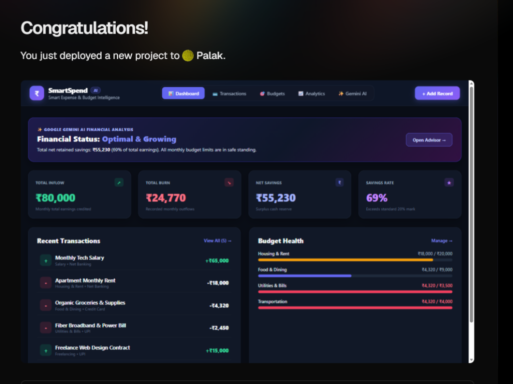
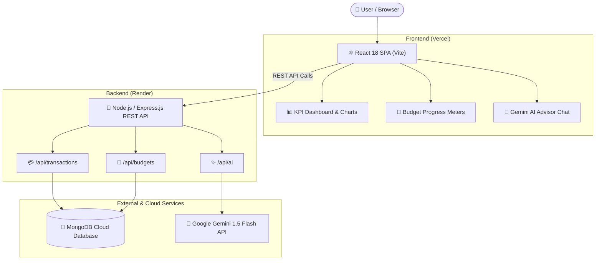

# 💰 Smart Expense & Budget Management System (SmartSpend AI)

<p align="center">
  
</p>

<p align="center">
  <strong>An Intelligent Full-Stack Personal Finance & Budget Optimization Platform Powered by Google Gemini AI</strong>
</p>

<p align="center">
  
  
  
  
  
  
  
</p>

<p align="center">
  <a href="https://smart-expense-budget-management.vercel.app"><strong>🚀 Live Demo</strong></a> •
  <a href="https://github.com/PalakKapila72/smart-expense-budget-management"><strong>💻 Source Code</strong></a> •
  <a href="#-key-features"><strong>✨ Key Features</strong></a> •
  <a href="#-system-architecture"><strong>🏗️ Architecture</strong></a>
</p>

---

## 🌟 Overview

**SmartSpend AI** is a modern personal finance and cash-flow management application. Unlike standard manual expense trackers, SmartSpend combines real-time budget tracking with **Google Gemini AI** to provide:
1. **Automated Transaction Categorization:** Simply type a brief description (e.g., *"Swiggy dinner"* or *"Uber commute"*), and Gemini AI automatically detects the category and flow type.
2. **Proactive Budget Monitoring:** Category caps with automatic color shifts (🟢 Safe, 🟡 80% Warning, 🔴 Exceeded).
3. **AI Financial Wellness Advisor:** Real-time **Financial Health Scoring (0–100)**, personalized savings roadmaps, and an interactive AI financial consultant chat.

---

## ✨ Key Features

- 📊 **Real-Time KPI Dashboard:** Instant metrics for Total Inflow (Earnings), Total Burn (Expenses), Net Savings, and Savings Retention Rate (%).
- 🎯 **Category Budget Limits:** Set monthly limits for Food, Rent, Utilities, Transport, etc. Live progress bars visually alert users when approaching caps.
- 💳 **Transaction History & 1-Click CSV Export:** Filter by flow type (Income/Expense), category, or keyword search. Download spreadsheet-ready `.csv` reports with one click.
- 🔮 **Google Gemini AI Integration:**
  - Automated natural language classification of transactions.
  - Generates comprehensive financial wellness reports and actionable investment recommendations.
  - Interactive chatbot for custom financial advice.
- 🛡️ **Zero-Downtime Resilience:** Gracefully operates using an in-memory repository fallback if local MongoDB is offline.

---

## 🏗️ System Architecture



---

## 📂 Project Structure

```text
smart-expense-budget-management/
├── dashboard-preview.png          # High-resolution dashboard screenshot
├── README.md                      # Comprehensive project documentation
├── backend/                       # Express.js REST API
│   ├── server.js                  # Main server entry point
│   ├── config/db.js               # MongoDB connection with graceful fallback
│   ├── models/                    # Mongoose schemas (Transaction, Budget)
│   ├── routes/                    # API endpoints (transactions, budgets, AI)
│   └── services/geminiService.js  # Google Gemini AI SDK integration
└── frontend/                      # React.js application (Vite)
    ├── index.html                 # App HTML template
    ├── src/
    │   ├── App.jsx                # Main layout and tab orchestrator
    │   ├── index.css              # Custom fintech dark theme styling
    │   ├── components/            # Modular UI components
    │   └── services/api.js        # API service with production base URL
    └── vercel.json                # Vercel deployment rewrite rules
```

---

## ⚡ Quick Start (Local Setup)

### 1. Clone the repository
```bash
git clone https://github.com/PalakKapila72/smart-expense-budget-management.git
cd smart-expense-budget-management
```

### 2. Run Backend
```bash
cd backend
npm install
npm start
```
*Backend runs on `http://localhost:5000`*

### 3. Run Frontend (in a new terminal)
```bash
cd frontend
npm install
npm run dev
```
*Frontend opens at `http://localhost:3000`*

---

## 👨‍💻 Author

**Palak Kapila**  
- **GitHub:** [@PalakKapila72](https://github.com/PalakKapila72)  
- **LinkedIn:** [Palak Kapila](https://linkedin.com/in/palakkapila)  
- **Email:** palakkapila72@gmail.com
